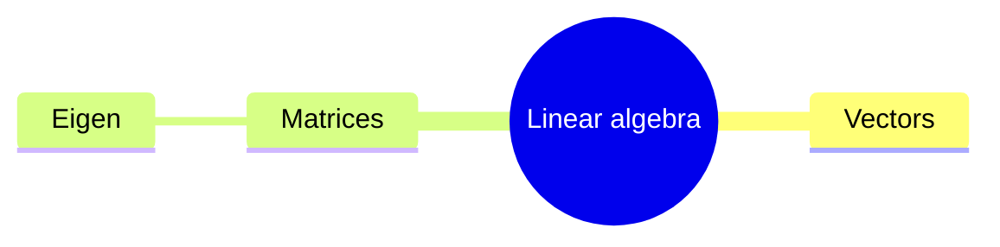

# Linear algebra

For $A \in \mathbb{R}^{n \times n}$, the eigen-equation is $A\mathbf{v} = \lambda \mathbf{v}$.

$$\det(A - \lambda I) = 0$$

> [!note] Remember
> $\operatorname{tr}(A) = \sum_i \lambda_i$

